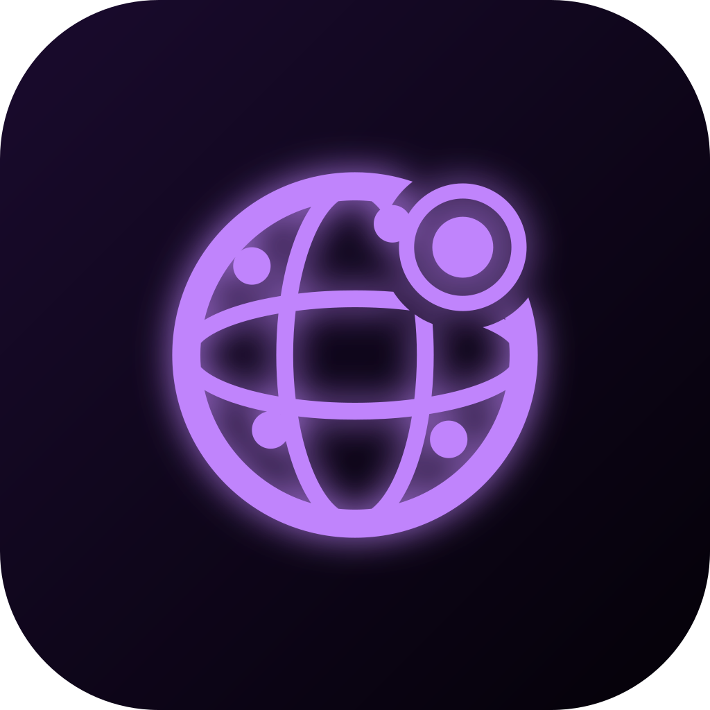
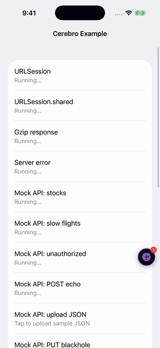
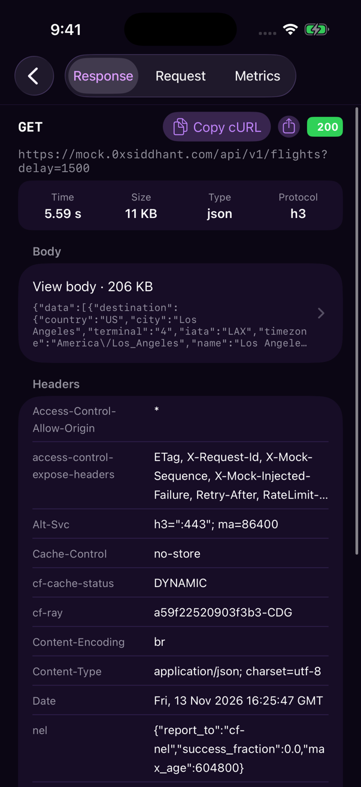

<p align="center"></p>

<h1 align="center">Cerebro</h1>

<p align="center"><b>See every request your iOS app makes, and every file it keeps, from inside the app.</b></p>

<p align="center">
  <a href="https://github.com/0xSiddhant/Cerebro/actions/workflows/ci.yml"></a>
  <a href="https://github.com/0xSiddhant/Cerebro/actions/workflows/release.yml"></a>
  <a href="https://github.com/0xSiddhant/Cerebro/releases/latest"></a>
  <a href="LICENSE"></a>
  <a href="#requirements"></a>
  <a href="Package.swift"></a>
  <a href="#swift-package-manager"></a>
  <a href="#cocoapods"></a>
</p>

Cerebro is a debug-only inspector that lives in your app. Add the package, call `Cerebro.start()`, and a floating button opens a dashboard with everything your app sent and received, live, with no proxy, no certificates and no Mac.

- **Every kind of traffic:** `URLSession`, including `URLSession.shared` and background sessions, `URLSessionWebSocketTask`, `NWConnection`, and [Server-Sent Events](docs/GUIDE.md#server-sent-events) as they stream in.
- **Readable payloads:** pretty JSON, gzip unpacked, and [protobuf decoded to JSON](docs/GUIDE.md#protobuf-decoding) from rules you write once.
- **Your app's files:** the [Files](docs/GUIDE.md#files) tab browses, previews, shares and changes what your app keeps on disk.
- **Answers, not just logs:** timings, sizes, connection details, [System Info](docs/GUIDE.md#system-info), and [previous sessions](docs/GUIDE.md#previous-sessions) that survive a crash.
- **Easy to share:** a request as cURL or JSON, or the whole session as [HAR](docs/GUIDE.md#export).
- **Safe by default:** it [turns itself off](docs/GUIDE.md#when-cerebro-runs) in TestFlight and App Store builds, [redacts](docs/GUIDE.md#redaction) what you choose before anything is stored, and sends nothing off the device unless you ask.

## Requirements

> [!IMPORTANT]
> **iOS and iPadOS 16+ · Swift 5.9 or later · No permissions · No `Info.plist` keys**
>
> One line of code to start. CI builds with Xcode 26.

## Screenshots

<p align="center"></p>

<table>
  <tr>
    <td align="center" valign="top"><br><sub>HTTP list</sub></td>
    <td align="center" valign="top"><br><sub>Log Inspector</sub></td>
    <td align="center" valign="top"><br><sub>Socket timeline</sub></td>
    <td align="center" valign="top"><br><sub>Files</sub></td>
  </tr>
</table>

The [Example](Example) app produced these, and it's a quick way to try Cerebro: open `Example/CerebroExample.xcodeproj` and run it on a simulator.

## Getting started

### 1. Install

Pick one of these three options. They all need the same code.

#### Swift Package Manager

In Xcode:

1. Choose **File > Add Package Dependencies**.
2. Enter `https://github.com/0xSiddhant/Cerebro.git`.
3. Set **Dependency Rule** to **Exact Version**, using the [latest release](https://github.com/0xSiddhant/Cerebro/releases/latest) number.
4. Add the **Cerebro** product to your app target. Add **CerebroProto** as well only if you decode protobuf.

In a `Package.swift`, with `X.Y.Z` as the [latest release](https://github.com/0xSiddhant/Cerebro/releases/latest):

```swift
.package(url: "https://github.com/0xSiddhant/Cerebro.git", exact: "X.Y.Z"),
```

```swift
.target(name: "MyApp", dependencies: [.product(name: "Cerebro", package: "Cerebro")]),
```

SPM also downloads `swift-protobuf`, because the package declares it. Only `CerebroProto` links it.

#### CocoaPods

Cerebro comes from Git and is never published to CocoaPods trunk, so a bare `pod 'Cerebro'` fails. Always include `:git`.

```ruby
platform :ios, '16.0'

target 'MyApp' do
  pod 'Cerebro', :git => 'https://github.com/0xSiddhant/Cerebro.git', :tag => 'vX.Y.Z'
end
```

Replace `X.Y.Z` with the [latest release](https://github.com/0xSiddhant/Cerebro/releases/latest), then run `pod install` and open the `.xcworkspace`. Pod tags start with `v`, and SPM versions don't.

#### XCFramework

1. Download [`Cerebro.xcframework.zip`](https://github.com/0xSiddhant/Cerebro/releases/latest/download/Cerebro.xcframework.zip) from the latest release and unzip it.
2. Drag `Cerebro.xcframework` into your project and tick your app target.
3. In the target's **General > Frameworks, Libraries, and Embedded Content**, set it to **Embed & Sign**. It's a dynamic framework, so without this the app crashes at launch with `Library not loaded: @rpath/Cerebro.framework/Cerebro`.

Capture only needs that one zip. To decode protobuf, also add [`CerebroProto.xcframework.zip`](https://github.com/0xSiddhant/Cerebro/releases/latest/download/CerebroProto.xcframework.zip) and [`SwiftProtobuf.xcframework.zip`](https://github.com/0xSiddhant/Cerebro/releases/latest/download/SwiftProtobuf.xcframework.zip) the same way. The release zips are built with Xcode 26, the only version CI tests, so use that or later.

### 2. Start Cerebro

Add one line as early as you can. Capture is added to a session's configuration when that configuration is created, so **a session or configuration made before `Cerebro.start()` isn't captured**. `URLSession.shared` is the one exception, because Cerebro reaches it another way.

UIKit:

```swift
import Cerebro
import UIKit

@main
final class AppDelegate: UIResponder, UIApplicationDelegate {
    func application(
        _ application: UIApplication,
        didFinishLaunchingWithOptions launchOptions: [UIApplication.LaunchOptionsKey: Any]? = nil
    ) -> Bool {
        Cerebro.start()
        return true
    }
}
```

SwiftUI:

```swift
import Cerebro
import SwiftUI

@main
struct MyApp: App {
    init() {
        Cerebro.start()
    }

    var body: some Scene {
        WindowGroup {
            ContentView()
        }
    }
}
```

Stored properties run first. If your `AppDelegate` or `App` has something like `let api = APIClient()`, that client exists before either method above runs, so create it after `Cerebro.start()` instead.

That one line is all most apps need. HTTP traffic and `URLSessionWebSocketTask` are captured from here on.

### 3. Open the dashboard

| Way | What it does |
|---|---|
| Floating button | Tap it to open the dashboard. Drag it to move it. Its number counts the requests since you last opened the dashboard |
| Shake | Hides or shows the floating button. It doesn't open the dashboard. In the simulator, use **Device > Shake** |
| `Cerebro.present()` | Opens the dashboard from your own debug menu or gesture. It does nothing while Cerebro is off |
| Close button | Top left of the dashboard. It returns you to your app |

`Cerebro.stop()` ends capture and removes the dashboard. A later `Cerebro.start()` begins a new session, and the one before it can still be read as a [previous session](docs/GUIDE.md#previous-sessions).

## Learn more

The [guide](docs/GUIDE.md) covers everything past setup:

| Topic | What's there |
|---|---|
| [Features](docs/GUIDE.md#features) | What Cerebro captures and what the dashboard shows |
| [Configuration](docs/GUIDE.md#configuration) | Every setting and its default |
| [Redaction](docs/GUIDE.md#redaction) | Hiding tokens, cookies and body fields. Nothing is redacted until you select it |
| [Traffic that needs code](docs/GUIDE.md#traffic-that-needs-code) | `NWConnection`, Starscream and Socket.IO |
| [Protobuf decoding](docs/GUIDE.md#protobuf-decoding) | Showing binary protobuf as JSON, with rules in code or in a `traffic_map.json` file |
| [System Info](docs/GUIDE.md#system-info) | Network status, addresses, performance, session totals, app and device info, and the opt-in public IP |
| [Previous sessions](docs/GUIDE.md#previous-sessions) | Reading the last session after a relaunch or a crash, and what's kept on disk |
| [Export](docs/GUIDE.md#export) | Sharing a request as cURL or JSON, or the whole session as HAR |
| [Files](docs/GUIDE.md#files) | Browsing, previewing, changing and sharing your app's files, and showing App Group containers |
| [When Cerebro runs](docs/GUIDE.md#when-cerebro-runs) | On in simulators and development-signed builds, off elsewhere unless you opt in |
| [What changes while Cerebro captures](docs/GUIDE.md#what-changes-while-cerebro-captures) | Side effects on your app's requests |
| [What Cerebro can't capture](docs/GUIDE.md#what-cerebro-cant-capture) | WKWebView, AVPlayer and other limits |
| [Troubleshooting](docs/GUIDE.md#troubleshooting) | Common problems and fixes |

## License

MIT. See [LICENSE](LICENSE).
