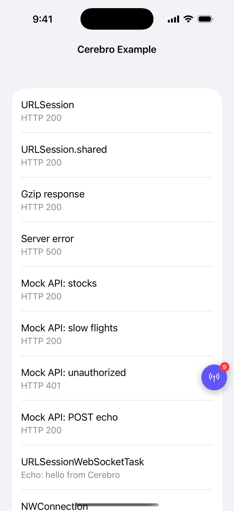

# Cerebro

[](https://github.com/0xSiddhant/Cerebro/actions/workflows/ci.yml)
[](https://github.com/0xSiddhant/Cerebro/actions/workflows/release.yml)
[](https://github.com/0xSiddhant/Cerebro/releases/latest)
[](LICENSE)
[](#requirements)
[](Package.swift)
[](#swift-package-manager)
[](#cocoapods)

A debug-only network inspector for iOS apps. Cerebro captures HTTP, WebSocket and NWConnection traffic and shows it in a dashboard inside your app. It is built around zero code change: add it, start it with one line, and the rest of your app stays as it is.

**Status:** early development. HTTP, WebSocket and NWConnection capture and the dashboard work today. The [roadmap](#roadmap) lists what comes next.

## Screenshots

<table>
  <tr>
    <td align="center" valign="top"><br><sub>Floating trigger</sub></td>
    <td align="center" valign="top"><br><sub>HTTP list</sub></td>
    <td align="center" valign="top"><br><sub>Log Inspector: Response</sub></td>
    <td align="center" valign="top"><br><sub>Log Inspector: Request</sub></td>
  </tr>
  <tr>
    <td align="center" valign="top"><br><sub>Log Inspector: Metrics</sub></td>
    <td align="center" valign="top"><br><sub>Body Viewer</sub></td>
    <td align="center" valign="top"><br><sub>Sockets</sub></td>
    <td align="center" valign="top"><br><sub>Socket timeline</sub></td>
  </tr>
</table>

The [Example](Example) app produced these, and it's a quick way to try Cerebro: open `Example/CerebroExample.xcodeproj` and run it on a simulator.

## Features

**Capture**

- `URLSession` traffic with no code change, including `URLSession.shared` and sessions made from `.default` or `.ephemeral` configurations.
- `URLSessionWebSocketTask` frames, pings, opens and closes with no code change.
- `NWConnection` through a drop-in wrapper, and any other socket engine through a one-line bridge.
- For each request: URL, method, query, headers, bodies, status and errors, plus a timing breakdown, sizes on the wire and after decoding, addresses, HTTP and TLS versions, and connection reuse.
- gzip and zlib bodies are decompressed for display.

**Dashboard**

- **Floating trigger:** sits above your app, drags anywhere and snaps to the nearest side, and counts the requests since you last looked.
- **HTTP list:** newest first and live, with search by URL, method or status, and filters for 2xx, 4xx, 5xx and failed requests.
- **Log Inspector:** Response, Request and Metrics pages for each request. Tap a row to expand it, or long-press to copy it.
- **Body Viewer:** pretty JSON or raw text, with copy and share buttons.
- **Sockets list:** every connection with its source (`WS`, `NW` or `EXT`), status, frame count and bytes sent and received.
- **Socket timeline:** each socket as a conversation with its frames, pings and state changes. Tap a frame to open it in the Body Viewer.
- **Copy and share:** copy any request as cURL from its page, or by swiping or long-pressing it in the list, and share a command or body as text or a file.

**Safe by default**

- Stays off in Ad Hoc, TestFlight and App Store builds unless you opt in. See [When Cerebro runs](#when-cerebro-runs).
- Redacts `Authorization`, `Proxy-Authorization`, `Cookie` and `Set-Cookie` before anything is stored, plus any headers, JSON keys and query parameters you add. Cerebro warns you before anything is shared.
- Keeps everything in memory, capped by count and size, and sends nothing off the device.
- Lives in its own window, so it never touches your navigation stack or takes touches outside its own views.

## Getting started

### Requirements

iOS or iPadOS 16+ and Swift 5.9 or later. CI builds with Xcode 26. Cerebro needs no permissions and no `Info.plist` keys.

### 1. Install

Pick one of these three options. They all need the same code.

> [!IMPORTANT]
> `v0.1.0`, the first release, only has placeholders: it builds and then captures nothing. Use a newer [release](https://github.com/0xSiddhant/Cerebro/releases/latest), whose notes list the exact lines for that version. If the latest release is still `v0.1.0`, use the `develop` lines below.

#### Swift Package Manager

In Xcode:

1. Choose **File > Add Package Dependencies**.
2. Enter `https://github.com/0xSiddhant/Cerebro.git`.
3. Set **Dependency Rule** to **Exact Version** with the release number, or to **Branch** with `develop`.
4. Add the **Cerebro** product to your app target. Leave `CerebroProto` set to **None**, because it's a placeholder until protobuf decoding ships.

In a `Package.swift`:

```swift
// While the latest release is v0.1.0:
.package(url: "https://github.com/0xSiddhant/Cerebro.git", branch: "develop"),

// From any later release:
.package(url: "https://github.com/0xSiddhant/Cerebro.git", exact: "X.Y.Z"),
```

```swift
.target(name: "MyApp", dependencies: [.product(name: "Cerebro", package: "Cerebro")]),
```

SPM also downloads `swift-protobuf`, because the package declares it. Only `CerebroProto` links it.

#### CocoaPods

Cerebro comes from Git and is never published to CocoaPods trunk, so a bare `pod 'Cerebro'` fails. Always include `:git`.

```ruby
platform :ios, '16.0'

target 'MyApp' do
  # While the latest release is v0.1.0:
  pod 'Cerebro', :git => 'https://github.com/0xSiddhant/Cerebro.git', :branch => 'develop'

  # From any later release:
  # pod 'Cerebro', :git => 'https://github.com/0xSiddhant/Cerebro.git', :tag => 'vX.Y.Z'
end
```

Run `pod install` and open the `.xcworkspace`. Pod tags start with `v`, and SPM versions don't.

#### XCFramework

Each [release](https://github.com/0xSiddhant/Cerebro/releases/latest) has three zips under **Assets**. Capture only needs `Cerebro.xcframework.zip`.

1. Download `Cerebro.xcframework.zip` and unzip it.
2. Drag `Cerebro.xcframework` into your project and tick your app target.
3. In the target's **General > Frameworks, Libraries, and Embedded Content**, set it to **Embed & Sign**. It's a dynamic framework, so without this the app crashes at launch with `Library not loaded: @rpath/Cerebro.framework/Cerebro`.

Leave out `CerebroProto.xcframework` and `SwiftProtobuf.xcframework` until protobuf decoding ships. The release zips are built with Xcode 26, the only version CI tests, so use that or later.

While the latest release is `v0.1.0`, build the XCFrameworks from `develop` instead, and use `build/xcframeworks/Cerebro.xcframework` in the steps above:

```sh
git clone --branch develop https://github.com/0xSiddhant/Cerebro.git
cd Cerebro
Scripts/build-xcframework.sh
```

### 2. Start Cerebro

Add one line as early as you can. Capture is added to a session's configuration when that configuration is created, so **a session or configuration made before `Cerebro.start()` isn't captured**. `URLSession.shared` is the one exception, because Cerebro reaches it another way.

UIKit:

```swift
import Cerebro
import UIKit

@main
final class AppDelegate: UIResponder, UIApplicationDelegate {
    func application(
        _ application: UIApplication,
        didFinishLaunchingWithOptions launchOptions: [UIApplication.LaunchOptionsKey: Any]? = nil
    ) -> Bool {
        Cerebro.start()
        return true
    }
}
```

SwiftUI:

```swift
import Cerebro
import SwiftUI

@main
struct MyApp: App {
    init() {
        Cerebro.start()
    }

    var body: some Scene {
        WindowGroup {
            ContentView()
        }
    }
}
```

Stored properties run first. If your `AppDelegate` or `App` has something like `let api = APIClient()`, that client exists before either method above runs, so create it after `Cerebro.start()` instead.

That one line is all most apps need. HTTP traffic and `URLSessionWebSocketTask` are captured from here on.

### 3. Open the dashboard

| Way | What it does |
|---|---|
| Floating button | Tap it to open the dashboard. Drag it to move it. Its number counts the requests since you last opened the dashboard |
| Shake | Hides or shows the floating button. It doesn't open the dashboard. In the simulator, use **Device > Shake** |
| `Cerebro.present()` | Opens the dashboard from your own debug menu or gesture. It does nothing while Cerebro is off |
| Close button | Top left of the dashboard. It returns you to your app |

`Cerebro.stop()` ends capture, removes the dashboard and discards what was captured. A later `Cerebro.start()` begins again with nothing.

## Configuration

Every setting is optional. `Cerebro.start()` uses the defaults, and calling it again while Cerebro runs does nothing, so call `stop()` first to change settings.

| Setting | Default | What it does |
|---|---|---|
| `allowsDistributionBuilds` | `false` | Runs capture in distribution-signed builds too. See [When Cerebro runs](#when-cerebro-runs) |
| `consoleLevel` | `.summary` | `.off`, `.summary` for one line per request, or `.full` for headers and bodies too |
| `requestLimit` | `500` | Requests kept. The oldest is dropped first |
| `bodyLimit` | `1_048_576` (1 MB) | Bytes stored for each request body, response body or socket frame. Longer ones are marked as truncated |
| `socketFrameLimit` | `1_000` | Frames and events kept for each socket. The oldest is dropped first |
| `redaction` | `RedactionRules()` | Extra headers, JSON keys and query parameters to redact |
| `isShakeGestureEnabled` | `true` | Whether a shake shows or hides the floating button |
| `decoders` | `[]` | Your own `BodyDecoder`s, tried in order, that turn a body Cerebro can't read into JSON |

```swift
Cerebro.start(CerebroConfiguration(
    consoleLevel: .full,
    requestLimit: 100,
    bodyLimit: 256 * 1024
))
```

### Redaction

`Authorization`, `Proxy-Authorization`, `Cookie` and `Set-Cookie` are always replaced with `[redacted]` before anything is stored. Add your own, in any letter case:

```swift
Cerebro.start(CerebroConfiguration(
    redaction: RedactionRules(
        headers: ["X-Api-Key"],
        jsonKeys: ["password", "token"],
        queryParameters: ["api_key"]
    )
))
```

- `jsonKeys` match at any depth, in HTTP bodies and socket frames. Setting them makes Cerebro parse JSON bodies at capture.
- A JSON body it can't parse or that passed `bodyLimit` is withheld rather than stored unredacted.
- Redaction only reads headers, query parameters and JSON. An HTTP body in another format, such as a URL-encoded form, is stored as it is.

## Traffic that needs code

iOS gives Cerebro no way to see these by itself, so each needs a small change. Skipping it only means that traffic isn't shown.

### NWConnection

Create a `MonitoredNWConnection` instead of an `NWConnection`. It has the same methods, and only forwards to the real connection while Cerebro is off.

```swift
import Cerebro
import Network

let connection = MonitoredNWConnection(host: "example.com", port: .https, using: .tls)
connection.stateUpdateHandler = { state in print(state) }
connection.start(queue: .main)
```

```swift
init(host: NWEndpoint.Host, port: NWEndpoint.Port, using parameters: NWParameters)
init(to endpoint: NWEndpoint, using parameters: NWParameters)
init(wrapping connection: NWConnection) // Keeps any state handler it already has.
```

Send and receive through the wrapper, because calls made directly on its `connection` property aren't recorded.

### Starscream, Socket.IO and other engines

Keep one `ExternalNetworkBridge.Connection` per socket, and make one call per frame or event:

```swift
let socket = ExternalNetworkBridge.Connection(name: "Prices", url: url)

ExternalNetworkBridge.log(.opened, on: socket)
ExternalNetworkBridge.log(.text(message), .sent, on: socket)
ExternalNetworkBridge.log(.binary(data), .received, on: socket)
ExternalNetworkBridge.log(.closed(code: 1000, reason: "done"), on: socket)
```

```swift
// On ExternalNetworkBridge:
struct Connection { init(name: String, url: URL? = nil) }
static func log(_ payload: SocketPayload, _ direction: SocketDirection, on connection: Connection)
static func log(_ event: SocketEvent, on connection: Connection)
```

| Type | Cases |
|---|---|
| `SocketPayload` | `.text(String)`, `.binary(Data)` |
| `SocketDirection` | `.sent`, `.received` |
| `SocketEvent` | `.opened`, `.closed(code: Int?, reason: String?)`, `.ping`, `.pong`, `.stateChanged(String)`, `.failed(String)` |

## When Cerebro runs

`Cerebro.start()` decides from how the app is signed. Every install option uses the same check.

| Build | Capture |
|---|---|
| Simulator | On |
| Development-signed (`get-task-allow` in the provisioning profile) | On |
| Ad Hoc, TestFlight, App Store | Off, unless `allowsDistributionBuilds` is `true` |

The check reads the signing, not the build configuration, so a Release build signed for development still captures. While Cerebro is off, nothing is hooked, no dashboard appears, `MonitoredNWConnection` only forwards and `ExternalNetworkBridge` does nothing.

To capture in a QA or TestFlight build, opt in:

```swift
Cerebro.start(CerebroConfiguration(allowsDistributionBuilds: true))
```

This turns capture on in every distribution build, App Store included, so set it only in builds that won't ship there.

### Leaving Cerebro out of Release builds

The check above already keeps Cerebro off, so this is optional.

With CocoaPods, add `:configurations => ['Debug']` to the `pod` line, and Release builds won't contain Cerebro at all. The module doesn't exist there, so guard your code with `canImport`:

```swift
#if canImport(Cerebro)
import Cerebro
#endif

// In your start-up code:
#if canImport(Cerebro)
Cerebro.start()
#endif
```

SPM and XCFrameworks link Cerebro in every configuration, so its code stays in the Release binary. Wrapping the import and the call in `#if DEBUG` only stops your code from calling it.

## What changes while Cerebro captures

Cerebro sends each request through its own session, which has these side effects in builds where it runs:

- Settings on your `URLSessionConfiguration` other than headers don't apply, such as timeouts, cellular access and cookie handling.
- The `urlSession(_:task:didSendBodyData:totalBytesSent:totalBytesExpectedToSend:)` upload progress callback doesn't fire.
- HTTP Basic, Digest and NTLM logins answered by a session delegate aren't answered, so your app receives the 401.
- A redirect your session delegate refuses arrives about 500 ms later. Followed redirects aren't delayed.

Certificate pinning and client certificates keep working, because those challenges still reach your delegate.

Cerebro keeps both the request and response body of up to 500 requests, so it can hold about 1 GB at worst. Lower `requestLimit` or `bodyLimit` if your app moves many large bodies. Sockets are capped separately: 100 connections and 100 times `bodyLimit` of payload (100 MB by default), and the socket idle longest goes first.

## What Cerebro can't capture

- WKWebView traffic
- AVPlayer streams
- gRPC over SwiftNIO
- Sockets not routed through `MonitoredNWConnection` or `ExternalNetworkBridge`
- Background `URLSession` transfers, for now. See the [roadmap](#roadmap)

## Troubleshooting

| What you see | Likely cause | Fix |
|---|---|---|
| The app runs, with no floating button and no capture | You installed `v0.1.0`, which only has placeholders | Install a newer release, or `develop`. See [Install](#1-install) |
| No floating button | `Cerebro.start()` didn't run, or the build is signed for distribution | Check the call runs. For Ad Hoc or TestFlight, set `allowsDistributionBuilds` |
| The floating button disappeared | A shake hid it | Shake again |
| Some requests are missing | Their session or configuration was made before `Cerebro.start()` | Call it earlier, and check stored properties on your `AppDelegate` or `App` |
| One session's requests are all missing | Your code assigned `protocolClasses`, which removes Cerebro's | Add to the array instead: `configuration.protocolClasses = (configuration.protocolClasses ?? []) + [MyProtocol.self]` |
| A socket is missing | It's a raw `NWConnection` or a third-party engine | See [Traffic that needs code](#traffic-that-needs-code) |
| A body says it's withheld | `jsonKeys` are set and the body couldn't be parsed or passed `bodyLimit` | Expected, because a body that can't be redacted isn't stored. Raise `bodyLimit` if it was cut off |
| `No such module 'Cerebro'` | The product isn't linked to this target, or you opened the `.xcodeproj` of a CocoaPods app | Add the `Cerebro` product to the target, or open the `.xcworkspace` |
| Crash at launch: `Library not loaded: @rpath/Cerebro.framework/Cerebro` | The XCFramework isn't embedded | Set it to **Embed & Sign** |
| Timeouts or cookies behave differently | Cerebro sends requests through its own session | See [What changes while Cerebro captures](#what-changes-while-cerebro-captures) |

## Roadmap

Not built yet:

- Protobuf decoding and a Proto Config tab
- A System Info tab, and HAR and raw JSON export
- Background `URLSession` capture, and keeping sessions across launches

## License

MIT. See [LICENSE](LICENSE).
